# HomeServe – Entity Relationship Diagram (ERD) & Schema Architecture

> [!NOTE]
> The **HomeServe** relational database is designed for **MySQL 8.0+** using the `InnoDB` storage engine with full ACID compliance, `utf8mb4_unicode_ci` collation, strict foreign-key referential integrity, and Third Normal Form (**3NF**) normalization across **28 tables**.

---

## 1. Comprehensive Mermaid Entity-Relationship Diagram (All 28 Tables)

```mermaid
erDiagram
    users ||--o| customers : "1:1 profile"
    users ||--o| service_providers : "1:1 profile"
    users ||--o| technicians : "1:1 profile"
    users ||--o{ addresses : "owns"
    users ||--o{ notifications : "receives"
    users ||--o{ password_reset_tokens : "requests"
    users ||--o{ refresh_tokens : "maintains"
    users ||--o{ coupon_usages : "redeems"
    users ||--o{ booking_images : "uploads"
    users ||--o{ booking_status_history : "audits"
    users ||--o{ complaints : "raises/resolves"

    service_providers ||--o{ technicians : "employs"
    service_providers ||--o{ provider_services : "offers"
    service_providers ||--o{ service_areas : "covers"
    service_providers ||--o{ availability_slots : "publishes"
    service_providers ||--o{ provider_working_hours : "schedules"
    service_providers ||--o{ bookings : "fulfills"
    service_providers ||--o{ provider_earnings : "earns"
    service_providers ||--o{ subscriptions : "subscribes"
    service_providers ||--o{ reviews : "receives"
    service_providers ||--o{ favorite_providers : "bookmarked_in"
    service_providers ||--o{ invoices : "issues"

    service_categories ||--o{ service_categories : "parent_of"
    service_categories ||--o{ services : "contains"
    services ||--o{ provider_services : "mapped_in"
    services ||--o{ bookings : "booked_for"
    services ||--o{ reviews : "rated_in"

    customers ||--o{ bookings : "places"
    customers ||--o{ payments : "initiates"
    customers ||--o{ invoices : "billed_to"
    customers ||--o{ reviews : "authors"
    customers ||--o{ favorite_providers : "saves"

    addresses ||--o{ bookings : "service_location"

    bookings ||--o{ booking_assignments : "dispatched_via"
    bookings ||--o{ booking_images : "documented_by"
    bookings ||--o{ booking_status_history : "tracks"
    bookings ||--o{ payments : "paid_via"
    bookings ||--o| invoices : "generates"
    bookings ||--o| reviews : "reviewed_in"
    bookings ||--o{ complaints : "disputed_in"
    bookings ||--o| provider_earnings : "settled_in"
    bookings ||--o{ coupon_usages : "discounted_by"

    technicians ||--o{ booking_assignments : "executes"
    payments ||--o| invoices : "receipt_for"
    coupons ||--o{ coupon_usages : "applied_in"

    users {
        int id PK
        string full_name
        string email UK
        string phone UK
        string password_hash
        enum role "admin|customer|provider|technician"
        string avatar_url
        boolean is_active
        boolean is_email_verified
        datetime created_at
        datetime updated_at
    }

    customers {
        int id PK
        int user_id UK,FK
        int loyalty_points
        string preferred_language
        string emergency_contact
        datetime created_at
        datetime updated_at
    }

    service_providers {
        int id PK
        int user_id UK,FK
        string business_name
        text business_description
        int experience_years
        enum verification_status "pending|verified|rejected"
        string id_document_url
        string license_number
        text rejection_reason
        float avg_rating
        int total_reviews
        int total_completed_jobs
        float commission_rate
        boolean is_available
        datetime created_at
        datetime updated_at
    }

    technicians {
        int id PK
        int user_id UK,FK
        int provider_id FK
        string specialization
        int experience_years
        string id_proof_url
        enum availability_status "available|busy|offline"
        float avg_rating
        int total_jobs_completed
        boolean is_active
        datetime created_at
        datetime updated_at
    }

    addresses {
        int id PK
        int user_id FK
        string label
        string address_line1
        string address_line2
        string city
        string state
        string postal_code
        string country
        float latitude
        float longitude
        boolean is_default
        datetime created_at
        datetime updated_at
    }

    service_categories {
        int id PK
        int parent_id FK
        string name
        string slug UK
        text description
        string icon_name
        string image_url
        boolean is_active
        int display_order
        datetime created_at
        datetime updated_at
    }

    services {
        int id PK
        int category_id FK
        string name
        string slug UK
        string short_description
        text description
        float base_price
        int duration_minutes
        string image_url
        json inclusions_json
        json exclusions_json
        boolean is_featured
        boolean is_active
        datetime created_at
        datetime updated_at
    }

    provider_services {
        int id PK
        int provider_id FK
        int service_id FK
        float custom_price
        int custom_duration_minutes
        boolean is_active
        datetime created_at
    }

    service_areas {
        int id PK
        int provider_id FK
        string city
        string state
        string postal_code
        float service_radius_km
        boolean is_active
        datetime created_at
    }

    availability_slots {
        int id PK
        int provider_id FK
        date slot_date
        time start_time
        time end_time
        boolean is_booked
        datetime created_at
    }

    bookings {
        int id PK
        string booking_reference UK
        int customer_id FK
        int provider_id FK
        int service_id FK
        int address_id FK
        date appointment_date
        string appointment_time
        enum status "Pending|Confirmed|Provider Assigned|In Progress|Completed|Cancelled|Rejected"
        text problem_description
        string reference_image_url
        float base_amount
        float discount_amount
        float tax_amount
        float total_amount
        float commission_amount
        float provider_earning_amount
        string coupon_code
        text cancellation_reason
        string cancelled_by_role
        datetime created_at
        datetime updated_at
    }

    booking_assignments {
        int id PK
        int booking_id FK
        int technician_id FK
        int assigned_by_user_id FK
        enum assignment_status "Assigned|Accepted|Rejected|Arrived|In Progress|Completed"
        datetime arrival_time
        datetime start_time
        datetime completion_time
        text completion_remarks
        datetime created_at
        datetime updated_at
    }

    booking_images {
        int id PK
        int booking_id FK
        int uploaded_by_user_id FK
        enum image_type "reference|before|after|issue"
        string image_url
        string caption
        datetime created_at
    }

    booking_status_history {
        int id PK
        int booking_id FK
        string old_status
        string new_status
        int changed_by_user_id FK
        text notes
        datetime created_at
    }

    payments {
        int id PK
        int booking_id FK
        int customer_id FK
        string razorpay_order_id UK
        string razorpay_payment_id
        string razorpay_signature
        string payment_method
        enum payment_type "full|advance|remaining"
        float amount
        string currency
        enum status "Pending|Paid|Failed|Refunded"
        string idempotency_key UK
        text refund_reason
        datetime refunded_at
        datetime paid_at
        datetime created_at
        datetime updated_at
    }

    invoices {
        int id PK
        string invoice_number UK
        int booking_id UK,FK
        int payment_id FK
        int customer_id FK
        int provider_id FK
        float subtotal
        float discount_amount
        float tax_amount
        float total_amount
        datetime issued_at
        datetime due_date
        string pdf_url
        json billing_snapshot_json
        datetime created_at
    }

    coupons {
        int id PK
        string code UK
        string title
        text description
        enum discount_type "percentage|fixed"
        float discount_value
        float min_order_amount
        float max_discount_amount
        int usage_limit
        int used_count
        datetime valid_from
        datetime valid_until
        boolean is_active
        datetime created_at
        datetime updated_at
    }

    coupon_usages {
        int id PK
        int coupon_id FK
        int user_id FK
        int booking_id FK
        float discount_applied
        datetime used_at
    }

    reviews {
        int id PK
        int booking_id UK,FK
        int customer_id FK
        int provider_id FK
        int service_id FK
        int rating
        text comment
        text provider_response
        datetime provider_responded_at
        enum moderation_status "approved|flagged|hidden"
        datetime created_at
        datetime updated_at
    }

    complaints {
        int id PK
        string ticket_number UK
        int booking_id FK
        int raised_by_user_id FK
        int against_provider_id FK
        string category
        string subject
        text description
        enum status "Open|In Review|Resolved|Closed"
        enum priority "Low|Medium|High|Critical"
        text admin_resolution
        int resolved_by_user_id FK
        datetime resolved_at
        datetime created_at
        datetime updated_at
    }

    notifications {
        int id PK
        int user_id FK
        string title
        text message
        string notification_type
        int reference_id
        boolean is_read
        datetime created_at
    }

    provider_earnings {
        int id PK
        int provider_id FK
        int booking_id UK,FK
        float gross_amount
        float commission_percentage
        float commission_amount
        float net_earning
        enum payout_status "pending|processed|paid"
        datetime payout_date
        datetime created_at
    }

    provider_working_hours {
        int id PK
        int provider_id FK
        int day_of_week
        string start_time
        string end_time
        boolean is_closed
        datetime created_at
    }

    favorite_providers {
        int id PK
        int customer_id FK
        int provider_id FK
        datetime created_at
    }

    subscriptions {
        int id PK
        int provider_id FK
        string plan_name
        enum plan_tier "Starter|Professional|Enterprise"
        float price
        enum billing_cycle "monthly|annual"
        float commission_rate
        int max_services
        int max_technicians
        enum status "active|expired|cancelled"
        datetime start_date
        datetime end_date
        string razorpay_subscription_id
        datetime created_at
    }

    password_reset_tokens {
        int id PK
        int user_id FK
        string token_hash UK
        datetime expires_at
        boolean is_used
        datetime created_at
    }

    refresh_tokens {
        int id PK
        int user_id FK
        string token_hash UK
        datetime expires_at
        boolean is_revoked
        string user_agent
        string ip_address
        datetime created_at
    }

    payment_webhook_events {
        int id PK
        string event_id UK
        string event_type
        json payload_json
        boolean processed
        datetime created_at
    }
```

---

## 2. Normalization & Integrity Rules (3NF Compliance)

| Design Principle | Implementation in HomeServe Schema |
| :--- | :--- |
| **First Normal Form (1NF)** | All columns store atomic values; multi-valued relationships (`provider_services`, `booking_images`, `service_areas`) are extracted into dedicated child tables. |
| **Second Normal Form (2NF)** | Every non-key attribute is fully functionally dependent on the primary key. Composite uniqueness constraints (`UNIQUE(provider_id, service_id)`, `UNIQUE(provider_id, slot_date, start_time)`) prevent duplicate entries while preserving surrogate `INT AUTO_INCREMENT` primary keys for fast joins. |
| **Third Normal Form (3NF)** | Role-specific attributes are separated from `users` into `customers`, `service_providers`, and `technicians` to eliminate transitive dependencies and null-heavy sparse columns. |
| **Double-Booking Prevention** | `availability_slots` enforces `UNIQUE(provider_id, slot_date, start_time)` combined with row-level locking (`SELECT ... FOR UPDATE`) and conflict checks against active bookings (`status NOT IN ('Cancelled', 'Rejected')`). |
| **Financial & Tax Immutability** | `bookings`, `payments`, `invoices`, and `provider_earnings` snapshot the exact financial breakdown (`base_amount`, `discount_amount`, `tax_amount`, `commission_amount`, `provider_earning_amount`) at transaction time so future catalog price changes never corrupt historical ledgers. |
| **Webhook Idempotency** | `payments.idempotency_key` (`UNIQUE`) and `payment_webhook_events.event_id` (`UNIQUE`) guarantee that duplicate Razorpay webhook deliveries are safely ignored without double-crediting. |
