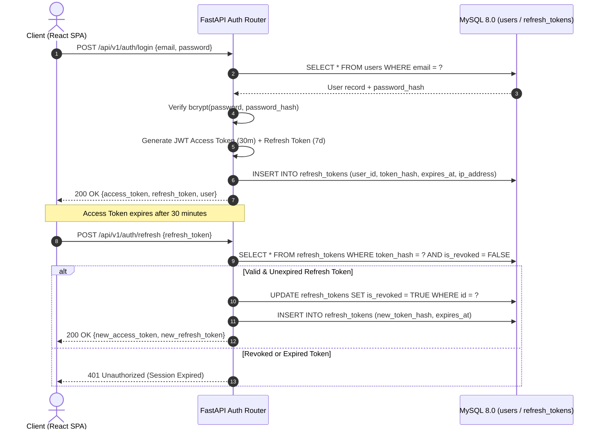
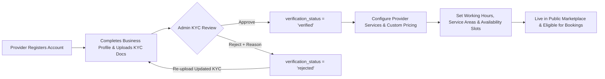
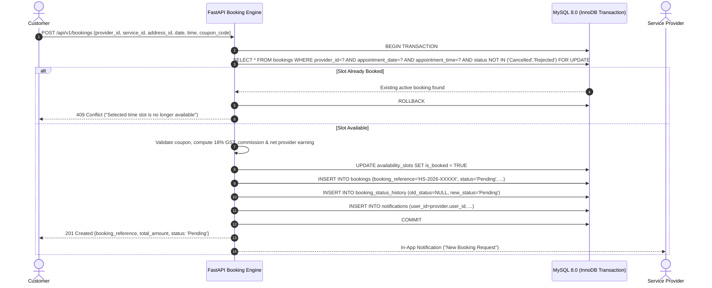
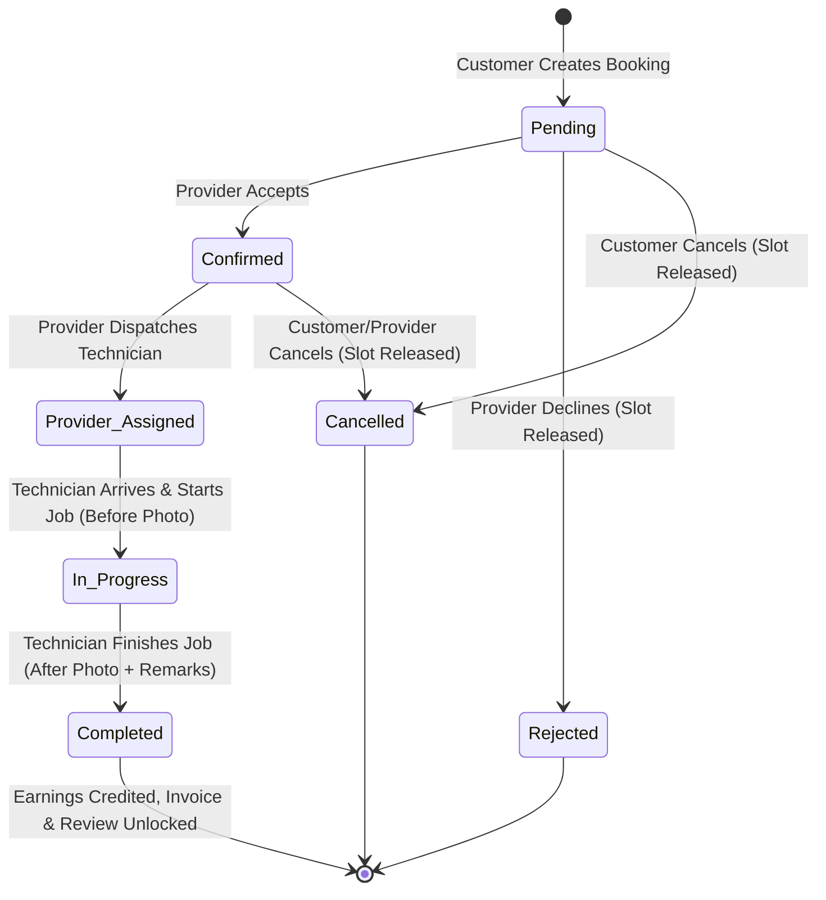
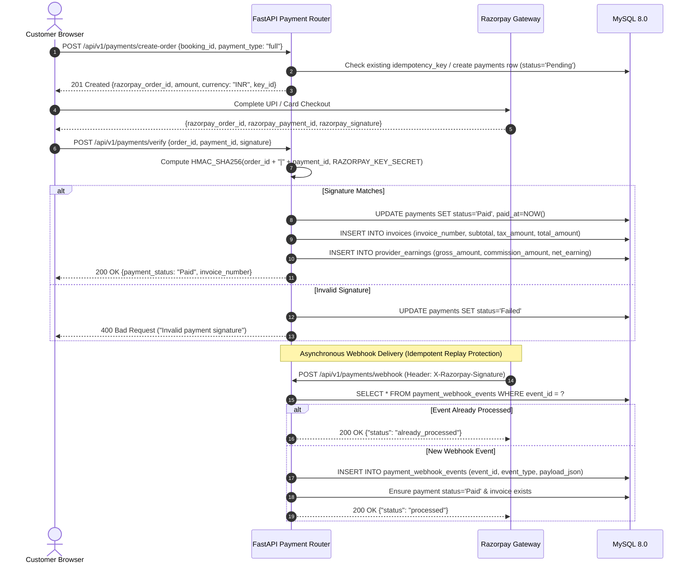
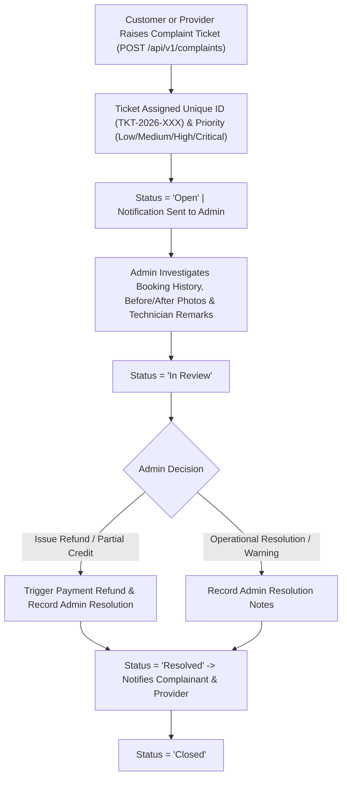

# HomeServe – System Workflows & Sequence Diagrams

> [!NOTE]
> This document details the core operational state machines, sequence diagrams, and concurrency safeguards powering **HomeServe**.

---

## 1. Authentication & Stateful Refresh Token Rotation Workflow

HomeServe implements a dual-token authentication architecture:
- **Access Token (JWT):** Short-lived (`30 minutes`), signed with `HS256`, carrying `sub` (user ID), `email`, and `role`.
- **Refresh Token:** Stateful token (`7 days`) whose SHA-256 hash is stored in the `refresh_tokens` table alongside `user_agent` and `ip_address`. Every refresh request atomically revokes the used refresh token (`is_revoked = TRUE`) and issues a new token pair.

---

## 2. Service Provider Onboarding & Admin KYC Verification Flow

Service providers register and upload KYC documentation (`id_document_url`, `license_number`). Until an Administrator approves the profile (`verification_status = 'verified'`), the provider cannot receive public customer bookings.

---

## 3. End-to-End Booking & Double-Booking Prevention Workflow

To prevent two customers from booking the same provider for the same date and time slot simultaneously, HomeServe checks both `availability_slots` (`UNIQUE(provider_id, slot_date, start_time)`) and active `bookings` (`status NOT IN ('Cancelled', 'Rejected')`) inside a single database transaction.

---

## 4. Booking & Technician Field Execution State Machine

Every booking progresses through a strictly validated state machine. Invalid state jumps (e.g., jumping from `Pending` directly to `Completed`) are blocked with HTTP `400 Bad Request`.

---

## 5. Razorpay Payment, HMAC-SHA256 Verification & Webhook Idempotency

HomeServe supports both client-side checkout callback verification and asynchronous Razorpay server-to-server webhooks (`payment.captured`).

---

## 6. Customer Dispute & Admin Complaint Resolution Workflow

