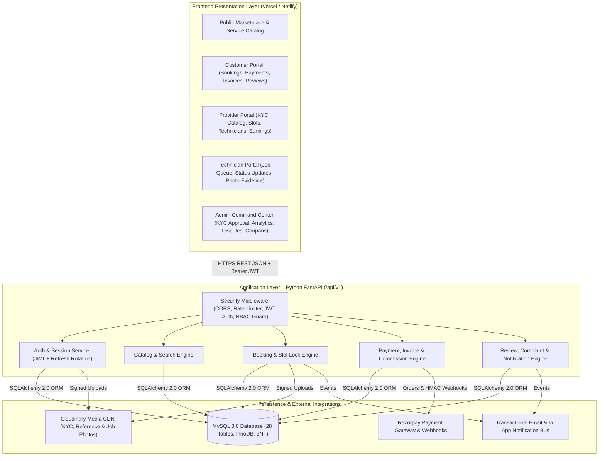

# HomeServe – Software Requirement Specification (SRS)

> [!IMPORTANT]
> **Document Version:** 2.0 (Enterprise Production Release)  
> **Project Title:** HomeServe – Multi-Role Home Services Booking SaaS Platform  
> **Architecture:** React 18 (Vite + Tailwind CSS) + Python FastAPI + MySQL 8.0 + Razorpay + Cloudinary

---

## 1. Executive Summary & System Overview

**HomeServe** is an end-to-end, multi-tenant Home Services Booking SaaS platform connecting homeowners (**Customers**) with verified service businesses (**Service Providers**), on-ground field specialists (**Technicians**), and platform operators (**Administrators**).

The platform streamlines the entire home maintenance lifecycle across **10 core service categories** (Electrical, Plumbing, AC Repair & Maintenance, Home Cleaning, Painting, Carpentry, Appliance Repair, Pest Control, Deep Cleaning, and Home Maintenance), supporting real-time slot availability, double-booking prevention, technician dispatch, before/after photographic evidence, Razorpay online payments with HMAC-SHA256 webhook verification, automated GST PDF invoices, commission & payout accounting, and dispute resolution.

---

## 2. High-Level System Architecture

---

## 3. Functional Requirements by Module

### Module 1: Authentication, Session & RBAC Management
- **FR-1.1:** Support unified registration and login for `customer`, `provider`, `technician`, and `admin` roles with email and phone uniqueness validation.
- **FR-1.2:** Hash passwords using `bcrypt` (cost factor 12) and issue short-lived JWT access tokens (`30 min`) paired with stateful, database-backed refresh tokens (`7 days`) with rotation and revocation.
- **FR-1.3:** Provide secure password reset token generation (`password_reset_tokens`) and profile management across all roles.

### Module 2: Service Catalog & Discovery Engine
- **FR-2.1:** Maintain 10 top-level service categories and extensible subcategories (`parent_id`), with custom icons, slugs, display ordering, and active toggles.
- **FR-2.2:** Support rich service listings with base pricing, duration in minutes, JSON inclusion/exclusion checklists, featured flags, and provider-specific custom pricing (`provider_services`).
- **FR-2.3:** Enable multi-criteria search, category filtering, price-range filtering, rating filtering, and city/postal-code serviceability lookup.

### Module 3: Provider Onboarding, KYC & Subscription SaaS
- **FR-3.1:** Allow providers to submit business details, GST/license numbers, and KYC documents (`id_document_url`) for Admin verification (`pending` -> `verified` / `rejected`).
- **FR-3.2:** Restrict public booking visibility to `verified` and `is_available = TRUE` providers.
- **FR-3.3:** Support provider SaaS subscription plans (`Starter`, `Professional`, `Enterprise`) governing platform commission rates (`10%–15%`), maximum services, and technician seats.

### Module 4: Availability Slots & Double-Booking Prevention
- **FR-4.1:** Allow providers to configure weekly working hours (`provider_working_hours`) and publish date-specific time slots (`availability_slots`).
- **FR-4.2:** Enforce atomic slot reservation (`UNIQUE(provider_id, slot_date, start_time)`) and reject concurrent or overlapping booking requests for the same provider and slot.

### Module 5: End-to-End Booking & Technician Dispatch Lifecycle
- **FR-5.1:** Generate human-readable unique booking references (e.g., `HS-2026-10001`) capturing problem descriptions, customer addresses, reference photos, and itemized tax/discount calculations.
- **FR-5.2:** Enforce strict state machine transitions: `Pending` -> `Confirmed` -> `Provider Assigned` -> `In Progress` -> `Completed` (or `Cancelled` / `Rejected`), logging every transition in `booking_status_history`.
- **FR-5.3:** Enable providers to assign available technicians (`booking_assignments`) and technicians to record arrival timestamps, start/completion timestamps, completion remarks, and before/after service photos (`booking_images`).

### Module 6: Razorpay Payments, Coupons, Commissions & GST Invoices
- **FR-6.1:** Validate promotional coupons (`WELCOME20`, `SUMMER15`, `HOME500`) against minimum order value, expiry window, maximum discount cap, and usage limits.
- **FR-6.2:** Create Razorpay orders with unique `idempotency_key` values and verify payment completion via cryptographic `HMAC-SHA256` signature checks and idempotent webhook processing (`payment_webhook_events`).
- **FR-6.3:** Automatically compute 18% GST (`tax_amount`), platform commission (`commission_amount`), and net provider earnings (`provider_earning_amount`), generating downloadable invoices (`invoices`).

### Module 7: Ratings, Reviews, Complaints & Admin Analytics
- **FR-7.1:** Allow customers to submit 1–5 star reviews exclusively for `Completed` bookings (`UNIQUE(booking_id)`), dynamically recalculating `service_providers.avg_rating` and `total_reviews`.
- **FR-7.2:** Provide a structured dispute/complaint ticketing system (`complaints`) with priority levels (`Low`, `Medium`, `High`, `Critical`) and admin resolution workflows.
- **FR-7.3:** Deliver role-specific analytics dashboards displaying revenue trends, booking status distributions, commission ledgers, top services, and provider performance KPIs.

---

## 4. Role Permissions Matrix (RBAC)

| Capability / Resource | Admin | Customer | Service Provider | Technician | Public (Unauthenticated) |
| :--- | :---: | :---: | :---: | :---: | :---: |
| Browse Categories, Services & Verified Providers | ✅ | ✅ | ✅ | ✅ | ✅ |
| Register Account / Login / Refresh Token | ✅ | ✅ | ✅ | ✅ | ✅ |
| Manage Saved Addresses & Favorite Providers | ❌ | ✅ | ❌ | ❌ | ❌ |
| Create Booking, Apply Coupon & Pay via Razorpay | ❌ | ✅ | ❌ | ❌ | ❌ |
| Cancel Pending/Confirmed Booking (Own) | ✅ (All) | ✅ (Own) | ✅ (Assigned) | ❌ | ❌ |
| Submit KYC Documents & Manage Provider Profile | ✅ (Review) | ❌ | ✅ (Own) | ❌ | ❌ |
| Configure Provider Services, Areas & Time Slots | ❌ | ❌ | ✅ (Own) | ❌ | ❌ |
| Onboard & Manage Technicians | ✅ (View) | ❌ | ✅ (Own) | ❌ | ❌ |
| Accept/Reject Booking & Assign Technician | ✅ (Override)| ❌ | ✅ (Own) | ❌ | ❌ |
| Update Field Job Status (Arrived / In Progress / Completed) | ❌ | ❌ | ✅ (Own) | ✅ (Assigned) | ❌ |
| Upload Before / After / Issue Job Photos | ❌ | ✅ (Ref) | ✅ | ✅ (Assigned) | ❌ |
| Download GST Invoice | ✅ (All) | ✅ (Own) | ✅ (Own) | ❌ | ❌ |
| Submit Rating & Review (Completed Booking) | ❌ | ✅ (Own) | ❌ | ❌ | ❌ |
| Respond to Customer Review | ❌ | ❌ | ✅ (Own) | ❌ | ❌ |
| Moderate / Flag Reviews & Resolve Complaints | ✅ | ❌ | ❌ | ❌ | ❌ |
| Manage Categories, Services & Promotional Coupons | ✅ | ❌ | ❌ | ❌ | ❌ |
| View Platform-Wide Revenue & Commission Analytics | ✅ | ❌ | ❌ (Own Only) | ❌ | ❌ |

---

## 5. Non-Functional Requirements (NFRs)

| Category | Requirement Specification | Target Metric |
| :--- | :--- | :--- |
| **Performance** | Paginated REST APIs with indexed SQL queries on `status`, `appointment_date`, `category_id`, and `provider_id`. | `p95 < 250ms` read latency |
| **Security** | OWASP Top 10 compliance: Bcrypt password hashing, JWT + Refresh rotation, RBAC ownership guards, SQLAlchemy parameterized queries, HMAC-SHA256 webhook verification. | Zero unauthenticated data leaks |
| **Reliability & ACID** | All booking creations, slot reservations, payment verifications, and commission ledger updates execute inside atomic InnoDB transactions. | 99.9% transactional consistency |
| **Scalability** | Stateless FastAPI workers behind ASGI Uvicorn, decoupled media storage (Cloudinary), and connection-pooled MySQL 8.0 (`pool_pre_ping=True`). | 500+ concurrent requests |
| **Usability** | Mobile-first responsive UI built with Tailwind CSS, clear empty/loading/error states, and WCAG 2.1 AA contrast compliance. | 100% responsive across Desktop/Tablet/Mobile |

---

## 6. 9-Phase SDLC Roadmap & Evaluation Checklist

| Phase | Milestone Deliverable | Status |
| :--- | :--- | :---: |
| **Phase 1** | Requirement Analysis, 4-Role RBAC Matrix & Agile User Stories (`requirement_specification.md`, `user_stories.md`) | ✅ Completed |
| **Phase 2** | System Architecture, 28-Table 3NF MySQL Schema & Mermaid ERD (`schema.sql`, `seed.sql`, `er_diagram.md`) | ✅ Completed |
| **Phase 3** | FastAPI Backend Core, JWT + Refresh Rotation, RBAC Dependencies & SQLAlchemy 2.0 Models | ✅ Completed |
| **Phase 4** | Service Catalog, Provider KYC, Slot Inventory, Double-Booking Prevention & Technician Dispatch APIs | ✅ Completed |
| **Phase 5** | Razorpay Payment Orders, HMAC Webhook Verification, Coupons, Commissions & Invoice Engine | ✅ Completed |
| **Phase 6** | React 18 + Vite + Tailwind CSS Frontend across Public, Customer, Provider, Technician & Admin Portals | ✅ Completed |
| **Phase 7** | Automated Pytest Suite (Unit, API, Integration) & 20-Step E2E Scenario Validation (`testing_report.md`) | ✅ Completed |
| **Phase 8** | Security Hardening Audit, Rate Limiting, CORS & File Validation (`security_checklist.md`) | ✅ Completed |
| **Phase 9** | Cloud Deployment Guide, CI/CD Branch Strategy & AI Vibe Coding Log (`deployment_guide.md`, `ai_development_log.md`) | ✅ Completed |
