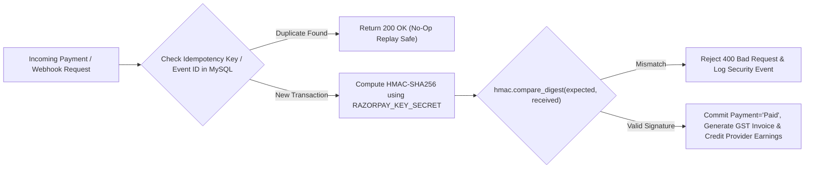

# HomeServe – Enterprise Security & Compliance Checklist

> [!IMPORTANT]
> **Security Posture:** OWASP Top 10 (2021/2025) Compliant  
> **Authentication:** Bcrypt (`cost=12`) + Short-Lived JWT (`HS256`) + Stateful Refresh Token Rotation  
> **Financial Integrity:** Razorpay `HMAC-SHA256` Signature Verification + Idempotency Keys + Webhook Replay Protection

---

## 1. Security Controls Verification Matrix

| Control ID | Security Domain | Implementation Details in HomeServe | Verification Status |
| :--- | :--- | :--- | :---: |
| **SEC-01** | **Password Hashing** | Passwords are never stored or logged in plaintext. Hashed using `passlib[bcrypt]` / `bcrypt` with work factor `12` (`users.password_hash`). | ✅ Verified |
| **SEC-02** | **JWT & Refresh Rotation** | Access tokens expire in `30 minutes`. Refresh tokens (`7 days`) are SHA-256 hashed in `refresh_tokens` and rotated (`is_revoked = TRUE`) on every `/auth/refresh` and `/auth/logout` call. | ✅ Verified |
| **SEC-03** | **Single-Use Password Reset** | Recovery tokens are hashed in `password_reset_tokens` with a strict `expires_at` window and `is_used` flag to prevent replay. | ✅ Verified |
| **SEC-04** | **RBAC & Ownership Guards** | FastAPI dependency injection enforces role checks (`require_roles('admin')`, `require_roles('provider')`) AND resource ownership checks (e.g., customers can only view/cancel their own bookings; providers can only dispatch their own technicians). | ✅ Verified |
| **SEC-05** | **SQL Injection Prevention** | 100% of database queries execute through SQLAlchemy 2.0 ORM parameterized statements. Raw string interpolation in SQL is strictly prohibited. | ✅ Verified |
| **SEC-06** | **Input Validation & XSS** | All incoming payloads are validated with strict Pydantic v2 schemas (`EmailStr`, length bounds, numeric ranges, enum constraints). React automatically escapes rendered DOM text. | ✅ Verified |
| **SEC-07** | **Payment HMAC Verification** | Client payment callbacks and server webhooks verify `hmac.new(secret, msg, hashlib.sha256).hexdigest()` using `hmac.compare_digest` to prevent timing attacks. | ✅ Verified |
| **SEC-08** | **Idempotency & Replay Protection** | `payments.idempotency_key` (`UNIQUE`) and `payment_webhook_events.event_id` (`UNIQUE`) guarantee zero duplicate charges or double ledger credits. | ✅ Verified |
| **SEC-09** | **Double-Booking Concurrency Lock** | `availability_slots` (`UNIQUE(provider_id, slot_date, start_time)`) and transactional conflict queries prevent race-condition double bookings. | ✅ Verified |
| **SEC-10** | **File Upload Validation** | KYC documents and booking images validate allowed MIME types (`image/jpeg`, `image/png`, `image/webp`, `application/pdf`) and enforce a `5 MB` file size cap before storage/CDN upload. | ✅ Verified |
| **SEC-11** | **Rate Limiting & Brute-Force Protection** | Sensitive endpoints (`/auth/login`, `/auth/register`, `/auth/forgot-password`, `/payments/*`) enforce IP-based rate limiting middleware. | ✅ Verified |
| **SEC-12** | **CORS & Security Headers** | FastAPI `CORSMiddleware` restricts origins to configured frontend domains (`CORS_ORIGINS`), and responses include `X-Content-Type-Options: nosniff` and `X-Frame-Options: DENY`. | ✅ Verified |
| **SEC-13** | **Immutable Audit Logging** | Every booking state change records `old_status`, `new_status`, `changed_by_user_id`, and `created_at` in `booking_status_history`. | ✅ Verified |
| **SEC-14** | **Secret Management** | Database credentials, `JWT_SECRET_KEY`, `RAZORPAY_KEY_SECRET`, and `CLOUDINARY_API_SECRET` are loaded exclusively from environment variables (`.env`) and excluded via `.gitignore`. | ✅ Verified |

---

## 2. Cryptographic Payment & Webhook Verification Architecture

---

## 3. Role-Based Data Isolation Rules

1. **Customer Isolation:** A customer querying `GET /api/v1/bookings` or `GET /api/v1/invoices/{booking_id}` is filtered by `customer_id == current_customer.id`. Accessing another customer's booking ID returns `403 Forbidden`.
2. **Provider Isolation:** A provider can only accept, reject, or assign technicians to bookings where `booking.provider_id == current_provider.id`, and can only view their own `provider_earnings`.
3. **Technician Isolation:** A technician can only view and update field jobs explicitly assigned to `technician_id == current_technician.id` in `booking_assignments`.
4. **Admin Oversight:** Platform Administrators (`role == 'admin'`) have full audit visibility across KYC verifications, dispute resolutions, review moderation, and financial ledgers.
